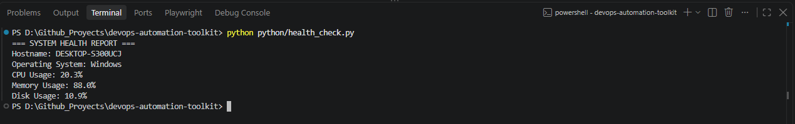
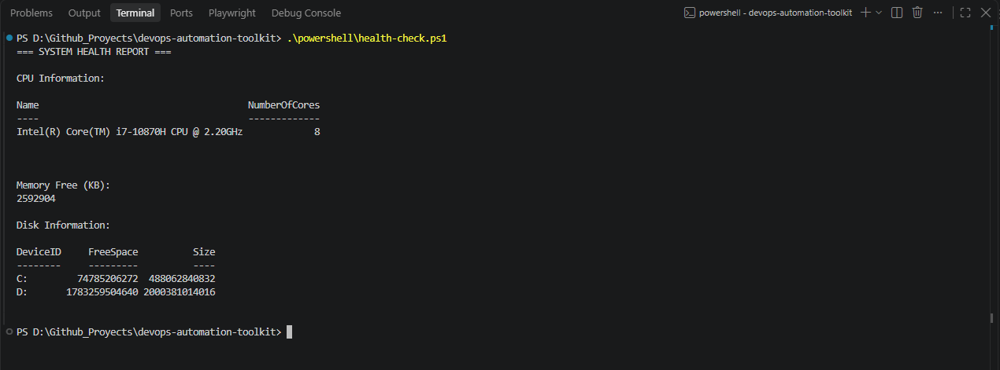
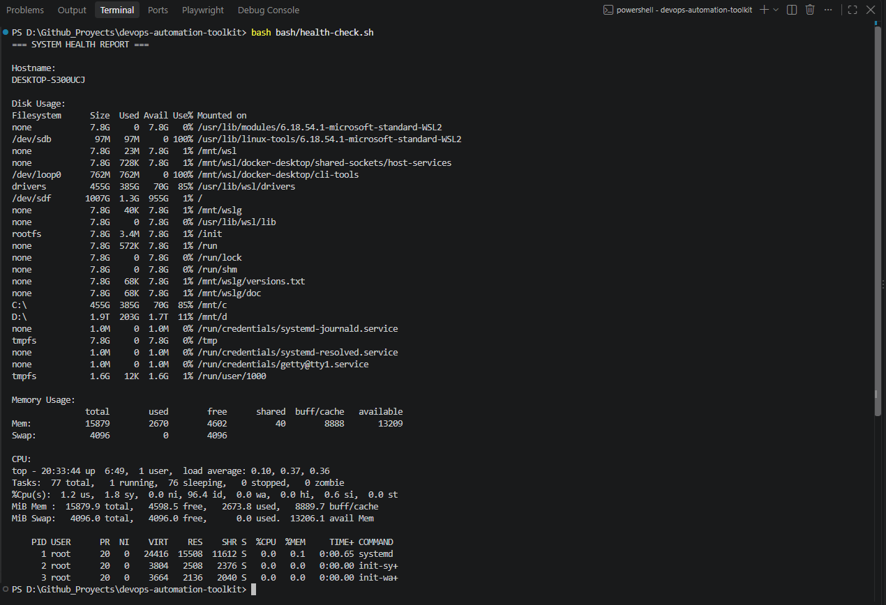
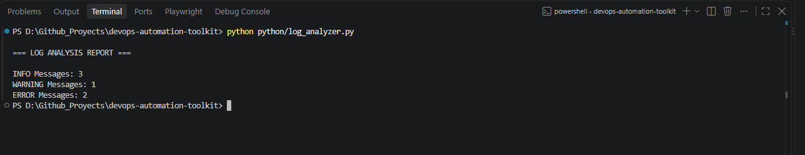
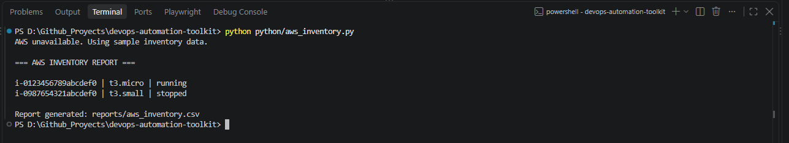
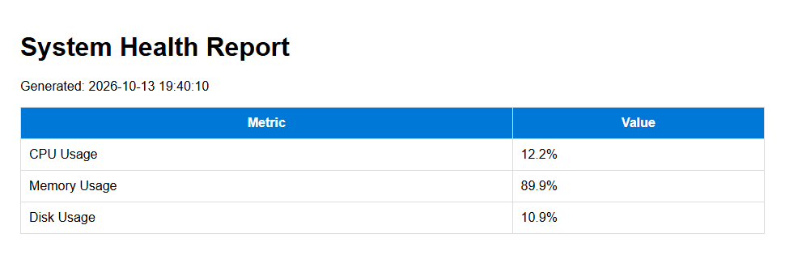

# DevOps Automation Toolkit


DevOps automation toolkit demonstrating Python, PowerShell, Bash, AWS inventory reporting, infrastructure reporting, GitHub Actions CI/CD, security scanning, and DevSecOps practices.

---

## Overview

This repository contains practical automation utilities commonly used by:

- DevOps Engineers
- Platform Engineers
- Cloud Engineers
- Site Reliability Engineers (SREs)
- Test Automation Engineers

The project demonstrates:

- Infrastructure Monitoring
- Log Analysis
- AWS Inventory Reporting
- Reporting Automation
- CI/CD Pipelines
- DevSecOps Controls
- Secret Scanning
- Security Analysis

---

## Features

✅ Python Automation

✅ PowerShell Automation

✅ Bash Automation

✅ System Health Monitoring

✅ Log Analysis

✅ AWS Inventory Reporting

✅ CSV Report Generation

✅ HTML Report Generation

✅ GitHub Actions CI/CD

✅ Automated Validation

✅ Secret Scanning

✅ Python Security Analysis

✅ Dependabot

✅ DevSecOps Controls

✅ Security Scanning

✅ GitLeaks

✅ Bandit

---

## Screenshots

### Python Health Check



---

### PowerShell Health Check



---

### Bash Health Check



---

### Log Analysis



---

### AWS Inventory Reporting



---

### HTML System Report



---

## Architecture

```text
Developer
    │
    ▼

GitHub Repository
    │
    ▼

GitHub Actions CI/CD
    │
    ├── Python Validation
    ├── PowerShell Validation
    ├── Bash Validation
    ├── Python Lint
    ├── Secret Scanning
    ├── Security Analysis
    │
    ▼

Automation Scripts
    │
    ├── Health Monitoring
    ├── Log Analysis
    ├── AWS Reporting
    └── Report Generation
```

---

## Repository Structure

```text
devops-automation-toolkit
│
├── .github/
│   ├── workflows/
│   │   ├── python-validation.yml
│   │   ├── powershell-validation.yml
│   │   ├── bash-validation.yml
│   │   ├── python-lint.yml
│   │   ├── gitleaks.yml
│   │   ├── bandit.yml
│   │
│   └── dependabot.yml
│
├── python/
│   ├── health_check.py
│   ├── log_analyzer.py
│   ├── aws_inventory.py
│   └── system_report.py
│
├── powershell/
│   └── health-check.ps1
│
├── bash/
│   └── health-check.sh
│
├── sample-data/
│   └── ec2_inventory.json
│
├── sample-logs/
│   └── app.log
│
├── docs/
│
├── reports/
│
├── SECURITY.md
├── requirements.txt
├── README.md
├── LICENSE
└── .gitignore
```

---

## Branch Strategy

```text
main

feature/health-checks

feature/log-analysis

feature/aws-inventory

feature/system-reporting

feature/github-actions

feature/security-scanning
```

---

## Installation

Clone the repository:

```bash
git clone https://github.com/hugotorrescoronado/devops-automation-toolkit.git

cd devops-automation-toolkit
```

Install dependencies:

```bash
pip install -r requirements.txt
```

---

## Dependencies

```text
psutil
boto3
```

---

## Health Monitoring

Run:

```bash
python python/health_check.py
```

---

## Log Analysis

Run:

```bash
python python/log_analyzer.py
```

---

## AWS Inventory Reporting

Run:

```bash
python python/aws_inventory.py
```

The tool supports:

- AWS Integration via Boto3
- Sample Inventory Data
- CSV Export Reporting

Generated file:

```text
reports/aws_inventory.csv
```

---

## System Reporting

Generate reports:

```bash
python python/system_report.py
```

Generated outputs:

```text
reports/system_report.csv

reports/system_report.html
```

---

## GitHub Actions

The repository automatically validates every:

```text
Push
Pull Request
```

### Validation Workflows

✅ Python Validation

✅ PowerShell Validation

✅ Bash Validation

✅ Python Lint

---

## Security Controls

### Secret Scanning

Gitleaks automatically scans the repository for:

- API keys
- Access Tokens
- Passwords
- Credentials
- Secrets

### Python Security Analysis

Bandit automatically scans Python code for:

- Insecure Imports
- Dangerous Functions
- Hardcoded Passwords
- Security Misconfigurations

### Dependabot

Dependabot automatically monitors:

- Python dependencies
- Security updates
- Package upgrades

---

## Local Validation

Python:

```bash
python python/health_check.py

python python/log_analyzer.py

python python/aws_inventory.py

python python/system_report.py
```

PowerShell:

```powershell
.\powershell\health-check.ps1
```

Bash:

```bash
bash bash/health-check.sh
```

Bandit:

```bash
bandit -r python
```

---

## Roadmap

### Phase 1 – Health Monitoring

- [x] Python Health Check
- [x] PowerShell Health Check
- [x] Bash Health Check

### Phase 2 – Log Analysis

- [x] Log Parsing
- [x] Error Reporting
- [x] Warning Reporting

### Phase 3 – AWS Inventory Reporting

- [x] AWS Inventory Utility
- [x] Sample Inventory Data
- [x] CSV Export

### Phase 4 – System Reporting

- [x] CSV Reports
- [x] HTML Reports
- [x] Infrastructure Reporting

### Phase 5 – GitHub Actions

- [x] Python Validation
- [x] PowerShell Validation
- [x] Bash Validation
- [x] Python Lint
- [x] CI/CD Automation

### Phase 6 – Security & DevSecOps

- [x] Gitleaks
- [x] Bandit
- [x] Dependabot
- [x] Security Policy
- [x] Secret Scanning
- [x] DevSecOps Controls

---

## Technologies

- Python
- PowerShell
- Bash
- AWS SDK (Boto3)
- GitHub Actions
- Gitleaks
- Bandit
- Dependabot
- DevSecOps
- CI/CD
- Security Automation
- CSV Reporting
- HTML Reporting
- Cloud Operations
- Platform Engineering
- Infrastructure Automation

---

## Security

See:

```text
SECURITY.md
```

for vulnerability disclosure and security controls.

---

## Status

✅ Portfolio Complete (v1.0.0)